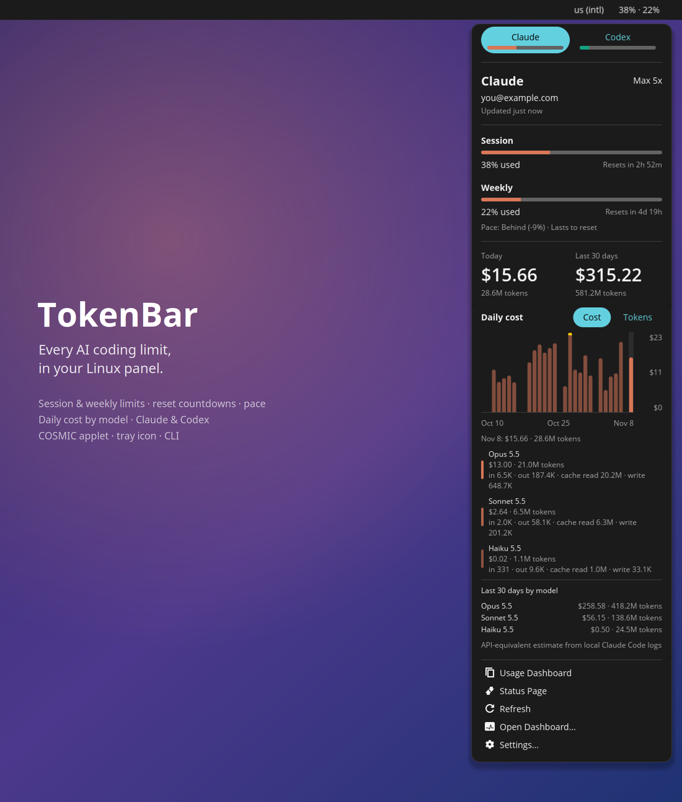
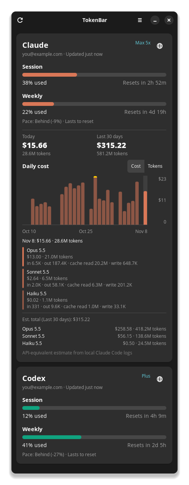

# TokenBar

**CodexBar-style AI usage monitor for Linux.** See your AI coding plan limits and spend from the panel. Inspired by [CodexBar](https://codexbar.app), which only runs on macOS.



In the panel, TokenBar shows your session and weekly usage (here `38% · 22%`). Click it for the popup above. Everything also works as a dashboard window, a tray icon on other desktops, and a CLI.

<p align="center">
  
</p>

<details>
<summary>Dashboard window</summary>
<p align="center"></p>
</details>

<sub>Screenshots use the built-in demo data (`TOKENBAR_DEMO=1`), not a real account.</sub>

## Features

- **In the panel:** % used of your 5-hour session and weekly limits, refreshed every 2 minutes. A ⚠ appears at 90%+ or when the provider's status page reports an incident.
- **Popup:**
  - provider, plan and account
  - each limit as a bar with "x% used" and a reset countdown
  - **pace**: whether you're ahead of or behind an even burn rate, and whether the limit lasts until it resets or when it runs out
  - extra usage / credits, when enabled
  - **spend** today and over the last 30 days
  - **daily cost history**: a bar per day (peak day capped in yellow), switchable between cost and tokens. Hover a day to see each model's cost and tokens (input, output, cache read, cache write). Below that, 30-day totals per model.
- **Dashboard window:** the same information in a larger window, plus preferences and notifications.
- **Desktop notifications** when a limit reaches 80% and 95%.
- **CLI:** `tokenbar usage` (coloured text) or `tokenbar usage --json`.

## Providers

| Provider | What's shown | Where the data comes from | You need |
|---|---|---|---|
| **Claude** (Pro / Max) | session, weekly, model-specific weekly limits, extra usage, account, plan, daily cost by model | Claude's OAuth usage endpoint (the same numbers as `/usage` in Claude Code), plus Claude Code's local logs (`~/.claude/projects/**/*.jsonl`) for cost | Claude Code logged in with your Claude account (`claude`) |
| **Codex** (ChatGPT plans) | session and weekly limits, credits, account, plan | ChatGPT's Codex usage endpoint | Codex CLI logged in with ChatGPT (`codex`) |

A provider that isn't set up on your machine is hidden.

### Notes on the numbers

- **Cost is an estimate.** It's what the tokens in your local logs would cost at Anthropic's API list prices. It is not what your subscription bills. Prices live in `tokenbar/claude_cost.py`.
- Cost only covers usage that went through Claude Code on **this machine**. The limits come from Anthropic's servers and include all your usage (claude.ai, other machines, and so on).
- **Pace** compares how much you've used with how much of the window has passed. "Behind (-3%)" means you've used 3 points less than an even burn would have by now.

## Privacy and credentials

- Reads the logins that Claude Code and the Codex CLI already store. It stores no passwords and asks for none.
- Credentials go only to the provider's own API (`api.anthropic.com`, `chatgpt.com`). Status checks use the public status pages. Nothing else is sent anywhere.
- The Claude token is **never refreshed** by this app: refresh tokens rotate, so refreshing here would log Claude Code out. When the token expires, the popup asks you to run `claude` once.
- The cost scan reads only the usage metadata in each log line (model, token counts, timestamp), not your prompts. Results are cached in `~/.cache/tokenbar/`.

## Does it work on any Linux?

It has three parts, and each needs something different:

| Part | Works on | Needs |
|---|---|---|
| **CLI** (`tokenbar usage`) | any Linux (and probably macOS) | Python 3.10+ only, no extra packages |
| **Dashboard window** + **tray icon** | most desktops | GTK 4, **libadwaita 1.5+**, PyGObject, pycairo. The tray icon needs a StatusNotifierItem host: KDE Plasma, COSMIC, XFCE, Cinnamon, MATE and Budgie have one; GNOME needs the *AppIndicator and KStatusNotifierItem Support* extension. |
| **Panel applet** (`38% · 7%` in the bar) | **COSMIC only** (Pop!_OS 24.04+, or COSMIC on Fedora, Arch, etc.) | Rust toolchain and xkbcommon headers to build |

libadwaita 1.5+ means Ubuntu 24.04+, Fedora 40+, Debian 13+, Arch/openSUSE Tumbleweed and similar. On older distros (Debian 12, Ubuntu 22.04) the CLI still works.

On a desktop other than COSMIC, use the tray icon (`tokenbar --hidden`). COSMIC draws tray icons as a ~16px square, which is why it gets the applet.

## Install

```bash
git clone https://github.com/eduardafa/tokenbar-linux.git && cd tokenbar-linux
./install.sh
```

`install.sh` installs everything per user under `~/.local` (no root):

- `~/.local/bin/tokenbar`: the CLI and the dashboard
- an app-library entry, "TokenBar"
- **on COSMIC with Rust installed**, it also builds `~/.local/bin/cosmic-applet-tokenbar`. The first build takes a few minutes.

If GTK or libadwaita are missing, the script prints the install command for your distribution (apt, dnf, pacman or zypper).

### COSMIC panel applet

1. Install Rust once (user-local, without editing your shell config files):
   ```bash
   curl --proto '=https' --tlsv1.2 -sSf https://sh.rustup.rs | sh -s -- -y --profile minimal --no-modify-path
   ```
2. Run `./install.sh`. Building needs the xkbcommon headers (`libxkbcommon-dev`). On Debian/Ubuntu/Pop!_OS without them, the script unpacks the package into `applet/.deps` with `apt download`, which needs no sudo. On other distros, install `libxkbcommon-devel` (Fedora) or `libxkbcommon` (Arch).
3. Add **TokenBar** in *Settings → Desktop → Panel → Configure panel applets*. The panel starts and stops the applet, so nothing needs to autostart.

### Other desktops (tray icon)

```bash
TOKENBAR_NO_APPLET=1 ./install.sh --autostart   # start the tray icon at login
tokenbar --hidden                               # or start it now
```

### Uninstall

```bash
./install.sh --uninstall   # keeps ~/.config/tokenbar
```

On COSMIC, also remove the applet from the panel in Settings.

## Usage

```bash
tokenbar                    # tray icon + dashboard window
tokenbar --hidden           # tray icon only
tokenbar --no-tray          # dashboard window only (what the applet opens)
tokenbar --preferences      # open preferences
tokenbar usage              # print usage and exit
tokenbar usage --json       # machine-readable, also what the applet reads
tokenbar usage --provider claude
```

## Settings

From **Settings…** in the popup (or Preferences in the dashboard), or in `~/.config/tokenbar/config.json`:

```json
{
  "refresh_seconds": 180,
  "providers": {"claude": true, "codex": true},
  "tray_metric": "session",
  "show_cost": true,
  "check_status": true,
  "notify_at_percent": [80, 95]
}
```

| Key | Meaning |
|---|---|
| `refresh_seconds` | refresh interval for the dashboard / tray icon (the applet refreshes every 2 minutes) |
| `providers` | turn providers on or off |
| `tray_metric` | which number the tray icon shows: `session`, `weekly`, or `highest` across providers |
| `show_cost` | scan local Claude Code logs for spend |
| `check_status` | poll provider status pages for incidents |
| `notify_at_percent` | notification thresholds; `[]` turns them off |

## Troubleshooting

| Problem | Fix |
|---|---|
| "Login expired. Run `claude` once" | The Claude Code token expired. Run `claude`; it refreshes the token. |
| Applet shows `AI –` | Run `tokenbar usage` in a terminal to see the error. |
| Applet missing after `./install.sh` | Make sure it's added in *Settings → Desktop → Panel*. If it still doesn't show, remove and re-add it there. |
| Panel applets stop responding after a monitor change | A COSMIC issue, not this app. Run `pkill -x cosmic-panel` (it restarts automatically) or log out and back in. |
| Cost is `$0` | Cost needs Claude Code session logs in `~/.claude/projects`. Usage through claude.ai isn't logged locally. |

## How it works

```
tokenbar/                 Python: data, CLI, dashboard (no pip dependencies)
  providers/claude.py          OAuth usage + profile endpoints
  providers/codex.py           ChatGPT Codex usage endpoint
  claude_cost.py               log scanner, price table, per-day/per-model aggregation
  status.py                    status pages (Statuspage API)
  cli.py                       `tokenbar usage [--json]`
  app.py, widgets.py           GTK 4 / libadwaita dashboard, preferences, notifications
  tray.py                      StatusNotifierItem + dbusmenu over D-Bus (tray icon)
applet/                        Rust: COSMIC panel applet (libcosmic)
  src/main.rs                  panel label + popup
  src/chart.rs                 daily cost chart (canvas)
  src/data.rs                  runs `tokenbar usage --json` and parses it
install.sh
```

The applet doesn't fetch anything itself. It runs `tokenbar usage --json`, so all provider logic lives in one place, the Python package.

### Adding a provider

Create `tokenbar/providers/<name>.py` with `ID`, `NAME` and `fetch(cfg) -> ProviderSnapshot`, then add it to `ALL` in `providers/__init__.py`. The CLI, dashboard and applet pick it up automatically. Give it a brand colour in `applet/src/main.rs` (`brand()`) and `tokenbar/widgets.py` (`BRAND`).

### Development

`TOKENBAR_DEMO=1` makes every part show deterministic demo data, which is how the screenshots were made. `cosmic-applet-tokenbar --preview out.png` renders the popup in a normal window, saves a screenshot and exits. Set `TOKENBAR_PREVIEW_PART=1|2|3` to capture it in parts when your screen isn't tall enough.

```bash
python3 -m tokenbar usage          # run from the repo, no install
python3 -m tokenbar --no-tray

cd applet
PKG_CONFIG_PATH=$PWD/.deps/root/usr/lib/x86_64-linux-gnu/pkgconfig cargo build --release   # PKG_CONFIG_PATH only if you used the .deps fallback
```

After reinstalling the applet, COSMIC may keep the old process running. Remove and re-add the applet in Settings, or run `pkill -x cosmic-panel`.

## Credits

The idea, layout and wording come from [CodexBar](https://github.com/steipete/CodexBar) by Peter Steinberger. TokenBar is an independent reimplementation for Linux and shares no code with it.
